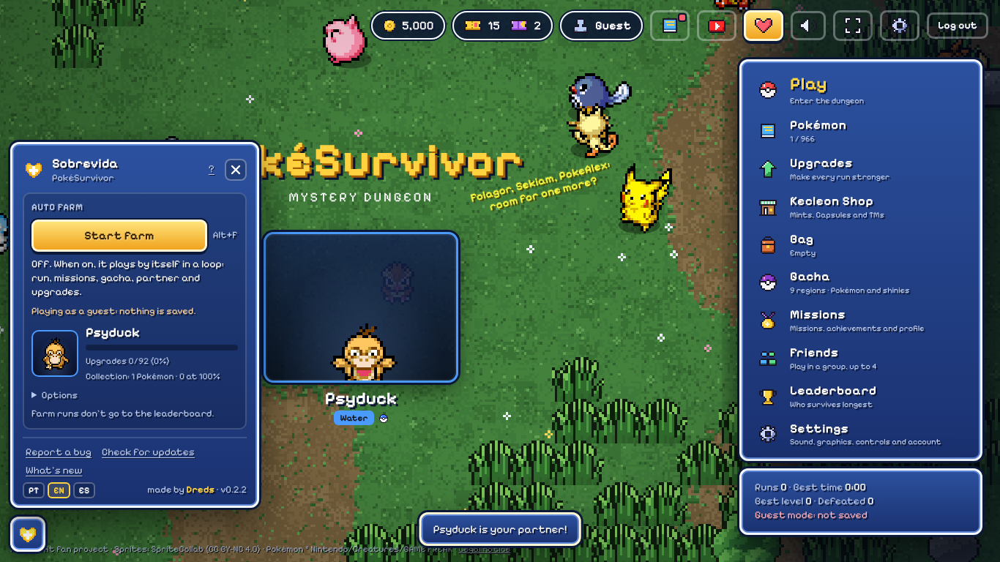
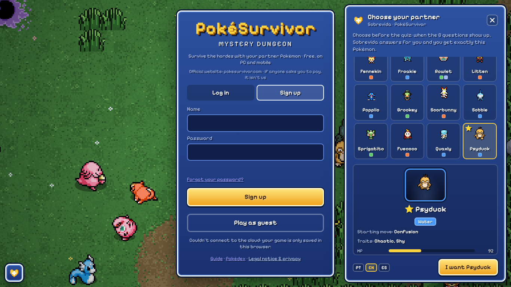
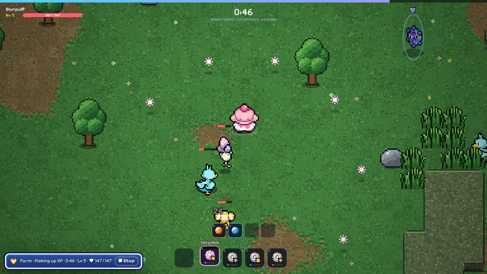
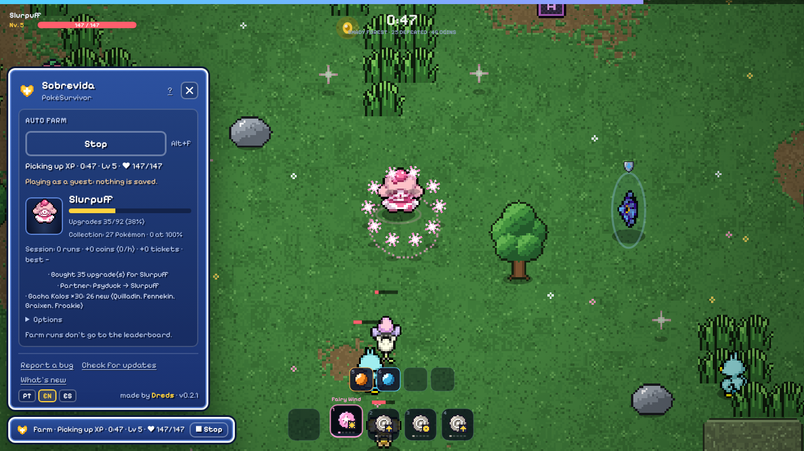
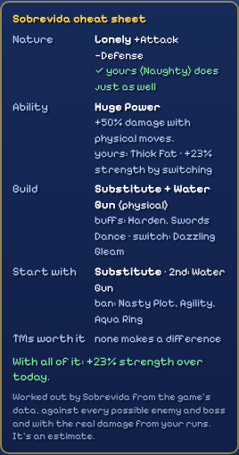
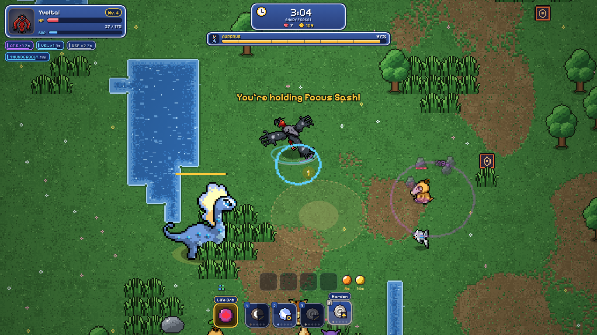
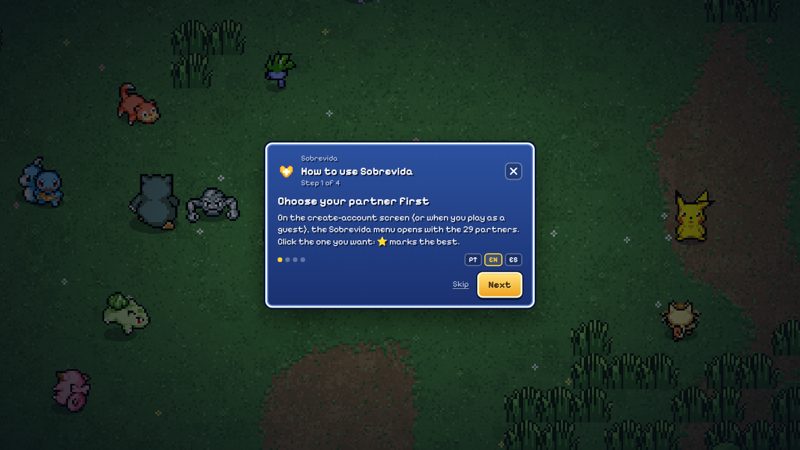

# Sobrevida

**A helper for [PokéSurvivor](https://pokesurvivor.com), built into the game.**
Choose your partner Pokémon before the 8-question personality quiz and get exactly that one. Then let the auto farm play runs, claim missions, pull the gacha and buy upgrades while you watch.

**Works on:** Chrome · Edge · Brave · Opera GX · Firefox 140+

---

## What it does

### Pick your partner before the quiz

When you create an account, PokéSurvivor asks 8 personality questions and gives you one of 29 starter Pokémon. Sobrevida opens a **Choose your partner** menu next to the sign-up form, drawn with the game's own sprites, types, starting move, traits and stats. Pick one, play the quiz, and Sobrevida answers the 8 questions for you so the result is exactly that Pokémon.

- Every one of the 29 starters is reachable. For the pairs the game breaks with a coin flip (Treecko/Froakie, Piplup/Quaxly), Sobrevida finishes through the game's own *Choose another* screen when the flip goes the wrong way.
- The **⭐** marks the best partner by the game's leaderboard (today: **Psyduck**).
- Already in the middle of the quiz? The menu opens there too, with **Answer it myself** if you'd rather play it.

### Auto farm

Open the heart menu and press **Start farm** (or **Alt+F** anywhere in the game). It plays by itself, in a loop:

- **In a run:** walks and dodges (enemies, ground markers, and projectiles along their whole path), picks up XP, chooses level-up cards, bonds and items, uses orbs, enters rifts, opens chests, chases the coin thief and escorts lost Pokémon.
- **Calculates the best build for each Pokémon.** Sobrevida reads every Pokémon, move and enemy from the game itself and works out the value of each move for your partner: damage per second at every level and after evolving (using the game's own upgrade ladders), physical/special side, mono-type bonus, weather abilities and effectiveness against the enemies that will show up in this run. From that it plans the build (2 main attacks, buffs and a switching partner) and picks level-up cards, move upgrades, fusions and the strongest partner. It also measures the real damage of each move in your runs and corrects itself. The panel shows the calculated build.
- **Sets the special upgrades.** Besides buying upgrades, it sets the Starting move, the Second starting move and the Bans (moves that won't show up in cards) from the same calculations, through the game's own Upgrades screen.
- **Uses the Kecleon Shop.** For your partner it works out how much stronger each nature (Mint), each ability (Ability Capsule / Hidden Ability Capsule) and each of today's TMs would make it. It only buys when the gain clears a minimum and beats the next Strength upgrade per coin, then uses the item on the Pokémon's page in the collection, through the game's own buttons. Items already in your Bag are used too. The math uses each Pokémon's real nature and ability, shown under the build in the panel.
- **Switches attacks for you.** Only the active move slot attacks in PokéSurvivor, and switching slots leaves the new slot almost ready. Right after a move fires, the farm switches to the slot that will be ready first (preferring super-effective moves), and slips buffs like Swords Dance and Harden in between so they stay stacked. In our lab runs this gave 3 to 7 times more damage per second than staying on one slot. It also fights bosses at the range of the move it's using instead of running away. Touch the arrow keys and you're in control; let go and it takes over again.
- **Between runs, in this order:**
  1. claims finished missions;
  2. pulls the gacha with your tickets: during Halloween on the ghost banner, otherwise on the region with the fewest Pokémon missing (closer to the Iris charm, which doubles shiny odds), or, with the option "prioritize the region where you have the fewest Pokémon", on the banner with the best chance of a new Pokémon per pull (rarity counts);
  3. switches your partner to **the strongest Pokémon you own that isn't at 100% yet**;
  4. buys that partner's upgrades, best value first, keeping a reserve of 10% of your coins (at most 1,500);
  5. saves to the cloud and starts the next run.
- **Never on the leaderboard.** Farm runs are blocked from the game's leaderboard twice: the game's submit is skipped, and the request that seals a run on PokéSurvivor's server is blocked by the browser before it leaves.
- **A panel that says what it's doing:** the current task or move, level and HP, your partner's upgrade progress, coins and tickets per hour, and the last things it did. During a run a small bar in the top-right corner (out of the way of the game) shows the same with **Stop**; with the farm off it stays there with **Start**, so you can open the menu or hand the run over to the farm at any moment. Every step can be turned off under *Options*.

&nbsp;&nbsp;

**Co-op.** The farm has a separate **Group** mode (a tab next to **Solo** in the heart menu) for runs with your friends, as the host or as a guest: each player steers their own Pokémon, so it only plays yours. As a guest, turn it on **before** the group run starts (a group run that started with the farm off is left alone); the host can turn it on at any time. In a room it never touches the menu between runs (no gacha, partner switch or solo run) and doesn't leave the results screen by itself. A group run with the farm on never reaches the leaderboard, for anyone in the group: the game only posts a group run with every member's seal, and Sobrevida blocks yours.

**Keep the game tab visible.** Browsers pause a game in a hidden tab and slow it down a lot in a minimized or covered window, so the farm can't play there. The panel tells you when that happens. Only one PokéSurvivor tab farms at a time; a second tab says the farm is running in the first one.

### Cheat sheet in the collection

For anyone who plays by hand: open one of your Pokémon in the game's collection and, right under its nature and ability, Sobrevida shows the best nature, the best ability (and whether it's the hidden one), the build (two main attacks, buffs and the switch move), which move to start with, what to ban and the TMs worth buying. When yours isn't the best, it says how much strength you'd gain by changing it. It uses the same calculations as the farm, but against every enemy and boss that can show up, so it doesn't change from run to run. In a run, the level-up card (or item, or bond) that the build would take gets a gold "Cheat sheet" badge (or the reroll button, when nothing fits), the pause screen shows the full cheat sheet for the Pokémon you're playing, and the new HUD has a strip with the build's moves, lit up once you have them. It's an estimate from the game's own data (and the real damage from your runs), not a guarantee. You can turn it off in the menu.

### New in-run look

The run's HUD gets redrawn in the game's own blue *Mystery Dungeon* style: a card for your Pokémon with its animated sprite, level, HP that turns green, yellow and red with a damage trail, and EXP underneath; buffs as chips with stacks, seconds left and a timer bar that blinks near the end; a clock panel with defeated count and coins; a boss panel with portrait and percentage; and a moves bar with a clock-style cooldown and the active move's seconds. It sits exactly where the game's own parts were, so clicks and taps on moves still work. You can switch back to the game's look in the menu ("New in-run look"), with or without the farm.

### Looks like the game

Panels, buttons, the font and the sprites come from PokéSurvivor's own *Mystery Dungeon* look, read from the game page at runtime. Nothing of the game is bundled with the extension.

## Install

### Chrome, Edge, Brave and Opera GX

1. Download **`sobrevida-vX.Y.Z.zip`** from the [latest release](https://github.com/DredsGG/sobrevida/releases/latest) and unzip it into a folder you'll keep.
2. Open `chrome://extensions` (Edge: `edge://extensions`, Brave: `brave://extensions`, Opera GX: `opera://extensions`).
3. Turn on **Developer mode** and click **Load unpacked**. Pick the folder.
4. Open [pokesurvivor.com](https://pokesurvivor.com) (reload it if it was already open).

Opera GX: if the extension disappears after you close the browser, load it again (a known Opera issue with unpacked extensions).

### Firefox 140+

1. Download **`sobrevida-vX.Y.Z.xpi`** from the [latest release](https://github.com/DredsGG/sobrevida/releases/latest) and confirm the install. If Firefox doesn't ask, use `about:addons` → gear icon → **Install Add-on From File**.
2. It updates itself.

No `.xpi` in the release yet? Use `about:debugging` → **This Firefox** → **Load Temporary Add-on** and pick `manifest.json` from the unzipped folder (it's removed when Firefox closes).

### Updating

Sobrevida checks this repository's releases by itself: when the game opens, every 30 minutes, and whenever you come back to the game tab (at most once every 10 minutes). When there's a new version, a notice appears in the middle of the screen with what changed and an **Update** button, but never during a run: notices, What's new and the tutorial wait for the menu so they can't cost you a run.

- **Chrome, Edge, Brave, Opera GX:** *Update* downloads the new zip. Unzip it **over the same folder**; the extension notices within a minute and reloads itself. Then reload the game tab (the panel shows a **Reload now** button), because the part that plays the game only starts with the page.
- **Firefox:** *Update* opens the signed `.xpi`. Firefox also updates it on its own.
- The **✕** only postpones the notice for an hour. A release marked **URGENTE** (a fix for a serious problem) shows the notice without ✕, and the farm stops until you update (a run already in progress finishes first).

## Languages

Everything is in **Portuguese, English and Spanish**: menus, the farm panel, notices, tutorial, *What's new* and the install guide. The first time, it follows your browser's language (any other language falls back to English). Switch any time with **PT · EN · ES** in the menu footer; the choice is saved.

## How it works

- **Two content scripts on `pokesurvivor.com`.** `src/content.js` draws the interface in a shadow DOM and answers the quiz by clicking the game's own buttons. `src/piloto.js` runs in the page (`"world": "MAIN"`, `document_start`) and reads the game's internal modules, the same way the existing community tools do, to play runs and to read your coins, tickets, Pokémon and upgrades. They talk through DOM events.
- **The quiz** follows the game's own rule (each answer adds points to two traits, the top pair decides the starter), so the answers are computed, not guessed.
- **It never edits your save.** Coins, tickets and Pokémon only change through the game's own buttons and screens (missions, gacha, upgrades, choose partner, save). It doesn't speed up the game or touch drop rates.
- **Permissions:** `storage` (settings, chosen partner, farm options), `alarms` (update checks), `downloads` (the update zip), `scripting` (to put a new version into tabs that are already open) and `declarativeNetRequest` (one rule, only while the farm is on, that blocks `ice.pokesurvivor.com/v1/seal`, so farm runs never reach the leaderboard). Host access to `pokesurvivor.com`, `ice.pokesurvivor.com` and `api.github.com` (latest release). **Nothing about you is collected or sent anywhere.**

## Tests

The game is never copied into this repository: the tests clone the public [PokéSurvivor repository](https://github.com/JPTER78/pokesurvivor) (the same build pokesurvivor.com serves) and serve it locally as `https://pokesurvivor.com`, with Firebase and the leaderboard seal faked.

- `tests/e2e.cjs`: Chromium with the real extension on a simulated quiz page with the game's IDs and rule: the picker, all 29 starters through the quiz (coin-flip pairs included), shuffled answers, *Stop*, *Answer it myself*, footer, languages, *What's new*, new-version and URGENTE notices.
- `tests/e2e-farm.cjs`: Chromium on the **real game**: quiz to Psyduck, the farm section, the seal blocked before the network, a run started and played by itself, missions/gacha/upgrades logged, one tab at a time, `Alt+F`.
- **Firefox** (GitHub Actions, `Test` workflow): `web-ext lint` with no errors, then real Firefox with the extension installed on the real game: tutorial, picker, quiz to Psyduck, the farm starting and playing a run, and no seal leaving.
- `tests/prints-github.cjs` makes the screenshots on this page (a fresh guest, no personal data).

See [tests/README.md](tests/README.md) to run them.

## Credits

- The in-run engine (movement, dodging, pathfinding, cards, bonds, items, rifts) is adapted from [PSBot](https://github.com/BoundlessEgret/pokesurvivor-autofarm) by BoundlessEgret, MIT. See [THIRD-PARTY-NOTICES](extension/THIRD-PARTY-NOTICES.md).
- [PokéSurvivor](https://pokesurvivor.com) is © 2026 JPTER78. Its sprites come from [SpriteCollab](https://github.com/PMDCollab/SpriteCollab) (CC BY-NC 4.0) and are loaded from the game's own site; none are included here.
- Pokémon is © Nintendo / Creatures Inc. / GAME FREAK / The Pokémon Company.

## Disclaimer

Unofficial fan tool, not affiliated with or endorsed by PokéSurvivor's developer or by Nintendo, Creatures, GAME FREAK or The Pokémon Company. Using an automation tool is your choice and your risk: farm runs are kept off the leaderboard on purpose, and the game's developer may change how the game works at any time, which can break the farm until Sobrevida is updated (use *Report a bug*). Free and non-commercial.

## License

[MIT](LICENSE) · made by [André Miller Fleck (Dreds)](https://github.com/DredsGG)
